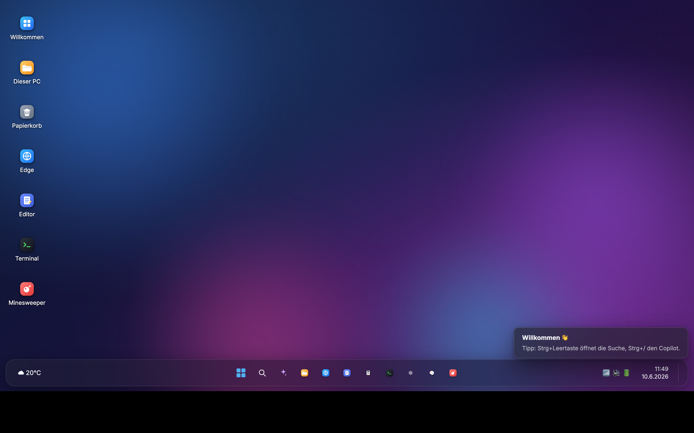
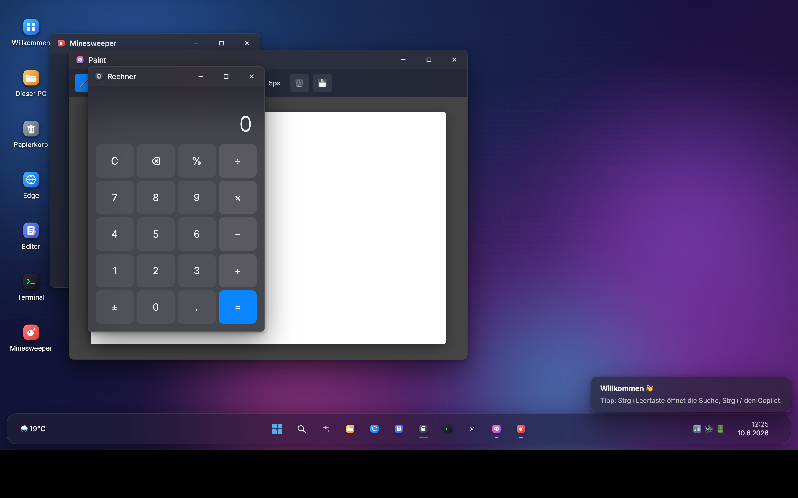

# Windows 12

> A complete Windows 12-style desktop environment that runs entirely in the browser — no frameworks.

Windows12 is a browser-based desktop operating system simulation built with pure HTML, CSS, and vanilla JavaScript. It recreates the look and feel of a modern Windows desktop, including a window manager, a virtual file system, a taskbar, a start menu, and a suite of working applications such as a file explorer, text editor, terminal, browser, paint app, and calculator. There is no build step and no dependencies — everything runs from static files.

> Note: The user interface is in German.

This is a fan project and is not affiliated with or endorsed by Microsoft. Windows, Edge and Copilot are trademarks of Microsoft.

## Features

- **Window manager** — Move, resize (8 handles), minimize, maximize, and snap layouts (edge docking, half/quarter tiling).
- **Virtual file system (VFS)** — A tree-structured file system persisted in `localStorage`. Create, rename, delete, read, and write folders and files.
- **File Explorer** — Sidebar, breadcrumb navigation, history, and context menus.
- **Terminal** — A built-in interpreter supporting commands such as `ls`, `cd`, `cat`, `mkdir`, `touch`, `rm`, `mv`, `cp`, `tree`, `grep`, `echo` (with `>` / `>>` redirection), `js` (run real JavaScript), `calc`, `curl` (real HTTP requests), `neofetch`, and `cowsay`.
- **Optional Python shell bridge** (`bridge.py`) — A local HTTP server that lets the web terminal execute real shell commands on your own machine. It only accepts requests from the app itself and requires a per-session token (see [Security](#security)).
- **Browser app** (Edge-style) — Google search rendered in an iframe, DuckDuckGo autocomplete, and Wikipedia search results.
- **Productivity apps** — Notepad-style editor with save (`Ctrl+S`) to the virtual file system, a calculator, and a Paint app using the Canvas API (brushes, shapes, export as PNG).
- **Games & utilities** — A fully playable Minesweeper, Task Manager, Clock, Photo Viewer, and Recycle Bin.
- **Command palette** (`Ctrl+Space`) — Search apps, files, and the web, plus inline calculations.
- **Copilot assistant** (`Ctrl+/`) — A rule-based chatbot that opens apps, changes the theme, performs calculations, fetches the weather, and searches the web.
- **Live weather** — Real weather data via the keyless Open-Meteo API, shown in the taskbar and widgets.
- **Personalization** — Light/dark mode, accent colors, multiple wallpapers, and an animated gradient-blob background.
- **System shell** — Boot, login, and shutdown screens, an action center, a calendar flyout, toast notifications, and selectable desktop icons.
- **Visual design** — A Fluent-style SVG icon set and a glassmorphism aesthetic.

## Tech Stack

- **HTML5**
- **CSS3** (glassmorphism, Flexbox / Grid)
- **Vanilla JavaScript** (ES6+, no frameworks)
- **Canvas API**
- **localStorage** (for VFS persistence)
- **Fetch API**
- **Python 3** (optional shell bridge via `http.server`)
- **External public APIs** — Open-Meteo (weather), DuckDuckGo and Wikipedia (search), all keyless

## Getting Started

No build is required and there are no dependencies to install.

**Option A — open directly**

Open `index.html` in your browser.

**Option B — run a local server** (recommended; some features behave better over HTTP)

```bash
python3 -m http.server 8000
```

Then visit [http://localhost:8000](http://localhost:8000) in your browser.

A copy hosted as a static site (for example on GitHub Pages) works the same way, just without the shell bridge.

**Optional — real shell commands in the terminal**

To let the in-app terminal run real commands on your machine, start the bridge:

```bash
python3 bridge.py          # prints a URL like http://127.0.0.1:8124/#bridge=<token>&port=8124
python3 bridge.py --open   # same, and opens that URL in your default browser
```

Open the printed URL. The bridge serves the app itself, so the terminal and the bridge share one origin. The token in the URL fragment is new on every start; the app keeps it for the current tab and removes it from the address bar. Stop the bridge with `Ctrl+C` when you are done.

If you prefer to serve the app from your own local server, allow that origin explicitly and open the second URL the bridge prints:

```bash
python3 bridge.py --allow-origin http://localhost:8000
```

## Security

The bridge executes arbitrary commands with your user rights, so it is locked down:

- **Localhost only.** It binds to `127.0.0.1` and is not reachable from your network.
- **Own origin only.** Requests with a foreign `Origin` header are rejected and no CORS headers are sent to other sites. Only the bridge's own origin (`http://127.0.0.1:<port>`, `http://localhost:<port>`) and origins passed with `--allow-origin` are accepted.
- **Host header check.** Requests whose `Host` is not `127.0.0.1:<port>` or `localhost:<port>` are rejected, which blocks DNS rebinding.
- **Session token.** `/ping` and `/exec` require the `X-Bridge-Token` header with a random token generated at startup (256 bit, compared in constant time). `/exec` also requires `Content-Type: application/json`, so a plain HTML form cannot trigger it.
- **Minimal file serving.** Only `index.html`, `css/` and `js/` are served; dotfiles, `bridge.py` and anything outside the project folder return 404.
- **Escaped web content.** The browser app inserts search suggestions and results from DuckDuckGo and Wikipedia as escaped text and opens only `http(s)` links, so a crafted result cannot run script in the page that holds the token.

Without a token the web app never contacts the bridge. Still: anyone who has the token can run commands as you, so don't share the URL, run the bridge only on your own machine and stop it after use. Earlier versions of `bridge.py` (before October 2026) sent `Access-Control-Allow-Origin: *` and had no token, so any open website could run commands while the bridge was running; don't use those versions.

## Project Status

Complete. The project is a self-contained, working demo with no known build issues. It is intended as a portfolio piece showcasing front-end engineering with vanilla JavaScript.

## How it was built

This project was built together with an AI coding agent (Claude Code). I decided what the desktop should do and how it should look, and tested the result; the agent wrote large parts of the code. The security hardening of the shell bridge (October 2026) was also done with Claude Code.

## Screenshots

<table>
  <tr>
    <td align="center"><br><sub>Desktop with live weather, taskbar & start</sub></td>
    <td align="center"><br><sub>Multiple apps open — Calculator, Paint & Minesweeper with a working window manager</sub></td>
  </tr>
</table>

## License

[MIT](LICENSE) © 2026 Aralim (AralimNGA)
